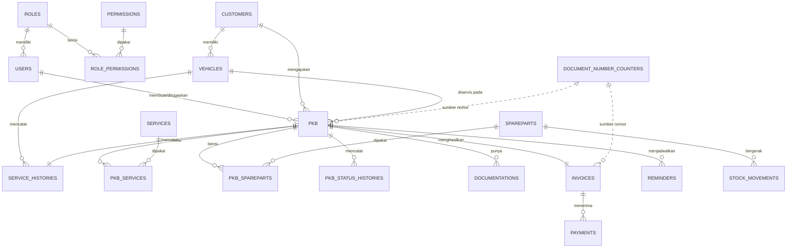
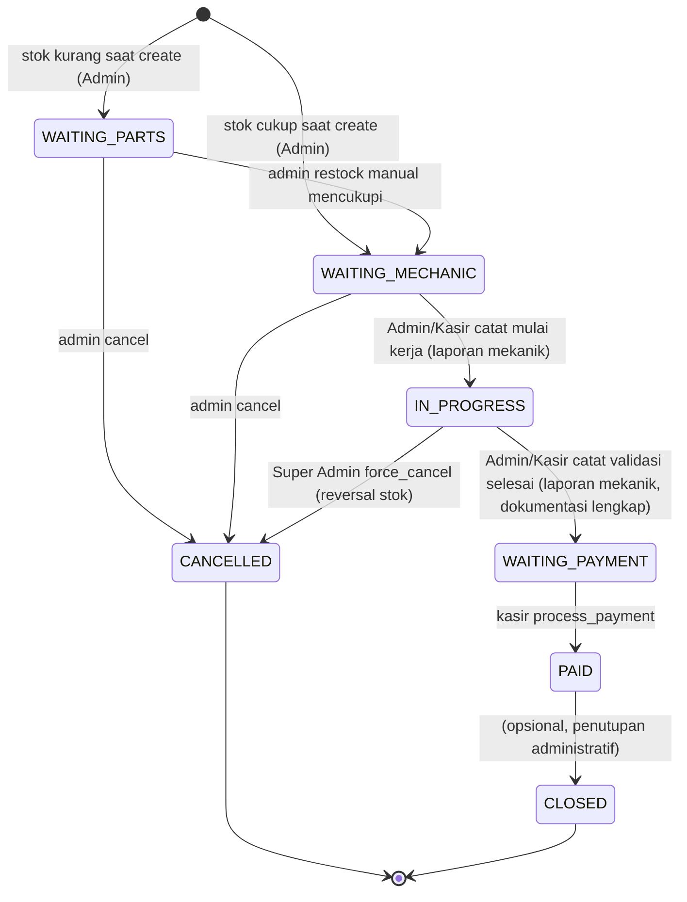

# Database & API — Spesifikasi Teknis Final
## TEFA Automotive Service Management (File 2 dari 5 — untuk pengembang/kamu pribadi)

**Versi:** 1.0 (konsolidasi seluruh keputusan teknis sampai 24 September 2026)
**Status:** Baseline tunggal — menggantikan draf ERD/SQL sebelumnya. Dokumen ini + Acuan Style (File 3) + Prompt per Fase (File 4) adalah tiga bahan yang selalu disuapkan bersama ke AI apa pun yang dipakai generate kode.

---

## 1. Prinsip Desain yang Mengikat Seluruh Skema

1. **Satu No. PKB** = satu kasus servis, status bertahap (bukan dokumen DO/WO/PI/Invoice terpisah).
2. **PO/Vendor dihapus sebagai modul.** Kekurangan stok cukup jadi status `WAITING_PARTS` + indikator di dashboard. Tidak ada tabel pengadaan formal.
3. **Rencana vs aktual dipisah**: `qty_planned` (saat admin input) tidak memotong stok; `qty_used` (saat mekanik konfirmasi) yang memotong stok.
4. **Snapshot harga** disimpan di baris transaksi (`unit_price`, `subtotal`), bukan hanya rujuk ke master — riwayat lama tidak berubah walau harga master di-update.
5. **Dokumentasi selektif**: wajib per item hanya jika `documentation_required = true` di master jasa/sparepart.
6. **Kasir memvalidasi kelengkapan dokumentasi**, bukan kualitas teknis pekerjaan.
7. **Mekanik tidak memegang device saat bekerja.** Bekerja berpedoman pada PKB cetak. Semua input progres (part aktual, dokumentasi, validasi selesai) dilakukan oleh Admin/Kasir berdasarkan laporan mekanik — mekanik hanya punya akses view-only ke tugas & riwayatnya sendiri.
8. **Pajak & diskon**: kolom disiapkan, **tidak aktif** di V1.
9. **Auth**: Laravel Sanctum, satu strategi (bearer token) untuk web dan Android, token tanpa expiry, revoke manual per-token.
10. **Reset password**: manual oleh Super Admin, tidak ada alur email.
11. **Storage foto dokumentasi**: local disk (`storage/app/public/documentations`).
12. **Proyek individu** — tidak ada tabel/alur terkait manajemen tim pengembang.

---

## 2. ERD Final



### Penjelasan tabel inti (yang bukan sekadar CRUD biasa)

| Tabel | Poin penting |
|---|---|
| `pkb` | `status` adalah state machine (lihat bagian 6). `estimated_total` dihitung saat create, `final_total` dihitung saat mekanik selesai (dari `qty_used` bukan `qty_planned`). |
| `pkb_spareparts` | Punya `qty_planned` DAN `qty_used` terpisah — inilah yang mencegah stok "hantu" berkurang sebelum barang benar dipakai. |
| `documentations` | Bisa terhubung ke `pkb_service_id` ATAU `pkb_sparepart_id` (nullable salah satu), jadi satu foto jelas untuk item mana. |
| `stock_movements` | Ledger append-only — setiap perubahan stok (kurang karena dipakai, tambah karena admin restock manual, reversal karena force-cancel) tercatat sebagai baris baru, bukan hanya update angka `stock_qty`. `stock_before`/`stock_after` memudahkan audit. |
| `pkb_status_histories` | Diisi otomatis oleh trigger (bagian 4), bukan ditulis manual dari kode — supaya tidak ada perubahan status yang lolos tak tercatat. |
| `document_number_counters` | Tabel baru (belum ada di SQL V1) — mengunci penomoran `PKB/YYYY/MM/0001` per bulan agar tidak tabrakan saat dua request datang bersamaan. |

---

## 3. Skema SQL Final

```sql
CREATE DATABASE IF NOT EXISTS tefa_automotive CHARACTER SET utf8mb4 COLLATE utf8mb4_unicode_ci;
USE tefa_automotive;

-- ================== AUTH & RBAC ==================
CREATE TABLE roles(
  id BIGINT UNSIGNED AUTO_INCREMENT PRIMARY KEY,
  name VARCHAR(50) UNIQUE NOT NULL,
  created_at TIMESTAMP NULL, updated_at TIMESTAMP NULL
) ENGINE=InnoDB;

CREATE TABLE permissions(
  id BIGINT UNSIGNED AUTO_INCREMENT PRIMARY KEY,
  code VARCHAR(100) UNIQUE NOT NULL,
  name VARCHAR(150) NOT NULL,
  created_at TIMESTAMP NULL, updated_at TIMESTAMP NULL
) ENGINE=InnoDB;

CREATE TABLE role_permissions(
  role_id BIGINT UNSIGNED NOT NULL,
  permission_id BIGINT UNSIGNED NOT NULL,
  PRIMARY KEY(role_id, permission_id),
  FOREIGN KEY(role_id) REFERENCES roles(id) ON DELETE CASCADE,
  FOREIGN KEY(permission_id) REFERENCES permissions(id) ON DELETE CASCADE
) ENGINE=InnoDB;

CREATE TABLE users(
  id BIGINT UNSIGNED AUTO_INCREMENT PRIMARY KEY,
  role_id BIGINT UNSIGNED NOT NULL,
  name VARCHAR(150) NOT NULL,
  username VARCHAR(100) UNIQUE NOT NULL,
  email VARCHAR(150) UNIQUE NULL,
  password VARCHAR(255) NOT NULL,
  is_active BOOLEAN DEFAULT TRUE,
  last_login_at TIMESTAMP NULL,
  created_at TIMESTAMP NULL, updated_at TIMESTAMP NULL,
  FOREIGN KEY(role_id) REFERENCES roles(id), INDEX(role_id)
) ENGINE=InnoDB;

-- ================== MASTER DATA ==================
CREATE TABLE customers(
  id BIGINT UNSIGNED AUTO_INCREMENT PRIMARY KEY,
  name VARCHAR(150) NOT NULL, phone VARCHAR(30) NOT NULL,
  email VARCHAR(150) NULL, address TEXT NULL, notes TEXT NULL,
  is_active BOOLEAN DEFAULT TRUE,
  created_at TIMESTAMP NULL, updated_at TIMESTAMP NULL,
  INDEX(phone)
) ENGINE=InnoDB;

CREATE TABLE vehicles(
  id BIGINT UNSIGNED AUTO_INCREMENT PRIMARY KEY,
  customer_id BIGINT UNSIGNED NOT NULL,
  plate_number VARCHAR(20) NOT NULL, brand VARCHAR(80) NOT NULL,
  model VARCHAR(100) NOT NULL, year SMALLINT UNSIGNED NULL,
  color VARCHAR(50) NULL, vin VARCHAR(100) NULL, engine_number VARCHAR(100) NULL,
  current_km INT UNSIGNED NULL, is_active BOOLEAN DEFAULT TRUE,
  created_at TIMESTAMP NULL, updated_at TIMESTAMP NULL,
  FOREIGN KEY(customer_id) REFERENCES customers(id),
  INDEX(customer_id), INDEX(plate_number), UNIQUE(vin)
) ENGINE=InnoDB;

CREATE TABLE services(
  id BIGINT UNSIGNED AUTO_INCREMENT PRIMARY KEY,
  code VARCHAR(50) UNIQUE NOT NULL, name VARCHAR(150) NOT NULL,
  description TEXT NULL, price DECIMAL(15,2) DEFAULT 0,
  documentation_required BOOLEAN DEFAULT FALSE, is_active BOOLEAN DEFAULT TRUE,
  created_at TIMESTAMP NULL, updated_at TIMESTAMP NULL
) ENGINE=InnoDB;

CREATE TABLE spareparts(
  id BIGINT UNSIGNED AUTO_INCREMENT PRIMARY KEY,
  code VARCHAR(50) UNIQUE NOT NULL, name VARCHAR(150) NOT NULL,
  unit VARCHAR(30) DEFAULT 'pcs',
  selling_price DECIMAL(15,2) DEFAULT 0, cost_price DECIMAL(15,2) DEFAULT 0,
  stock_qty DECIMAL(15,3) DEFAULT 0, min_stock DECIMAL(15,3) DEFAULT 0,
  documentation_required BOOLEAN DEFAULT FALSE, is_active BOOLEAN DEFAULT TRUE,
  created_at TIMESTAMP NULL, updated_at TIMESTAMP NULL
) ENGINE=InnoDB;

-- ================== PENOMORAN OTOMATIS ==================
CREATE TABLE document_number_counters(
  id BIGINT UNSIGNED AUTO_INCREMENT PRIMARY KEY,
  document_type ENUM('PKB','INVOICE') NOT NULL,
  year SMALLINT UNSIGNED NOT NULL, month TINYINT UNSIGNED NOT NULL,
  last_number INT UNSIGNED NOT NULL DEFAULT 0,
  UNIQUE(document_type, year, month)
) ENGINE=InnoDB;

-- ================== PKB (INTI SISTEM) ==================
CREATE TABLE pkb(
  id BIGINT UNSIGNED AUTO_INCREMENT PRIMARY KEY,
  number VARCHAR(50) UNIQUE NOT NULL,
  customer_id BIGINT UNSIGNED NOT NULL, vehicle_id BIGINT UNSIGNED NOT NULL,
  created_by BIGINT UNSIGNED NOT NULL, mechanic_id BIGINT UNSIGNED NULL,
  complaint TEXT NOT NULL, inspection_result TEXT NULL,
  status ENUM('WAITING_PARTS','WAITING_MECHANIC','IN_PROGRESS','WAITING_PAYMENT','PAID','CLOSED','CANCELLED') DEFAULT 'WAITING_MECHANIC',
  service_date DATETIME NOT NULL,
  estimated_total DECIMAL(15,2) DEFAULT 0, final_total DECIMAL(15,2) DEFAULT 0,
  started_at DATETIME NULL, completed_at DATETIME NULL,
  cancel_reason TEXT NULL,
  created_at TIMESTAMP NULL, updated_at TIMESTAMP NULL,
  FOREIGN KEY(customer_id) REFERENCES customers(id),
  FOREIGN KEY(vehicle_id) REFERENCES vehicles(id),
  FOREIGN KEY(created_by) REFERENCES users(id),
  FOREIGN KEY(mechanic_id) REFERENCES users(id),
  INDEX(customer_id), INDEX(vehicle_id), INDEX(mechanic_id, status), INDEX(service_date)
) ENGINE=InnoDB;

CREATE TABLE pkb_services(
  id BIGINT UNSIGNED AUTO_INCREMENT PRIMARY KEY,
  pkb_id BIGINT UNSIGNED NOT NULL, service_id BIGINT UNSIGNED NOT NULL,
  name_snapshot VARCHAR(150) NOT NULL, qty DECIMAL(15,3) DEFAULT 1,
  unit_price DECIMAL(15,2) NOT NULL, subtotal DECIMAL(15,2) NOT NULL,
  documentation_required BOOLEAN DEFAULT FALSE, is_done BOOLEAN DEFAULT FALSE,
  FOREIGN KEY(pkb_id) REFERENCES pkb(id) ON DELETE CASCADE,
  FOREIGN KEY(service_id) REFERENCES services(id), INDEX(pkb_id)
) ENGINE=InnoDB;

CREATE TABLE pkb_spareparts(
  id BIGINT UNSIGNED AUTO_INCREMENT PRIMARY KEY,
  pkb_id BIGINT UNSIGNED NOT NULL, sparepart_id BIGINT UNSIGNED NOT NULL,
  name_snapshot VARCHAR(150) NOT NULL,
  qty_planned DECIMAL(15,3) DEFAULT 0, qty_used DECIMAL(15,3) NULL,
  unit_price DECIMAL(15,2) NOT NULL, subtotal DECIMAL(15,2) NOT NULL,
  documentation_required BOOLEAN DEFAULT FALSE,
  FOREIGN KEY(pkb_id) REFERENCES pkb(id) ON DELETE CASCADE,
  FOREIGN KEY(sparepart_id) REFERENCES spareparts(id),
  INDEX(pkb_id), INDEX(sparepart_id)
) ENGINE=InnoDB;

CREATE TABLE pkb_status_histories(
  id BIGINT UNSIGNED AUTO_INCREMENT PRIMARY KEY,
  pkb_id BIGINT UNSIGNED NOT NULL,
  from_status VARCHAR(50) NULL, to_status VARCHAR(50) NOT NULL,
  changed_by BIGINT UNSIGNED NULL, note TEXT NULL,
  created_at TIMESTAMP DEFAULT CURRENT_TIMESTAMP,
  FOREIGN KEY(pkb_id) REFERENCES pkb(id) ON DELETE CASCADE,
  FOREIGN KEY(changed_by) REFERENCES users(id),
  INDEX(pkb_id, created_at)
) ENGINE=InnoDB;

-- ================== STOK (TANPA PO/VENDOR) ==================
CREATE TABLE stock_movements(
  id BIGINT UNSIGNED AUTO_INCREMENT PRIMARY KEY,
  sparepart_id BIGINT UNSIGNED NOT NULL,
  type ENUM('OUT','MANUAL_IN','ADJUSTMENT','RETURN') NOT NULL,
  reference_type VARCHAR(50) NULL, reference_id BIGINT UNSIGNED NULL,
  qty_in DECIMAL(15,3) DEFAULT 0, qty_out DECIMAL(15,3) DEFAULT 0,
  stock_before DECIMAL(15,3) NOT NULL, stock_after DECIMAL(15,3) NOT NULL,
  reason VARCHAR(255) NULL, created_by BIGINT UNSIGNED NOT NULL,
  created_at TIMESTAMP DEFAULT CURRENT_TIMESTAMP,
  FOREIGN KEY(sparepart_id) REFERENCES spareparts(id),
  FOREIGN KEY(created_by) REFERENCES users(id),
  INDEX(sparepart_id, created_at), INDEX(reference_type, reference_id)
) ENGINE=InnoDB;

-- ================== DOKUMENTASI ==================
CREATE TABLE documentations(
  id BIGINT UNSIGNED AUTO_INCREMENT PRIMARY KEY,
  pkb_id BIGINT UNSIGNED NOT NULL,
  pkb_service_id BIGINT UNSIGNED NULL, pkb_sparepart_id BIGINT UNSIGNED NULL,
  file_path VARCHAR(500) NOT NULL, file_name VARCHAR(255) NOT NULL,
  mime_type VARCHAR(100) NOT NULL, file_size BIGINT UNSIGNED NOT NULL,
  uploaded_by BIGINT UNSIGNED NOT NULL, uploaded_at DATETIME DEFAULT CURRENT_TIMESTAMP,
  FOREIGN KEY(pkb_id) REFERENCES pkb(id) ON DELETE CASCADE,
  FOREIGN KEY(pkb_service_id) REFERENCES pkb_services(id) ON DELETE CASCADE,
  FOREIGN KEY(pkb_sparepart_id) REFERENCES pkb_spareparts(id) ON DELETE CASCADE,
  FOREIGN KEY(uploaded_by) REFERENCES users(id), INDEX(pkb_id)
) ENGINE=InnoDB;

-- ================== INVOICE & PEMBAYARAN ==================
CREATE TABLE invoices(
  id BIGINT UNSIGNED AUTO_INCREMENT PRIMARY KEY,
  number VARCHAR(50) UNIQUE NOT NULL, pkb_id BIGINT UNSIGNED UNIQUE NOT NULL,
  subtotal DECIMAL(15,2) DEFAULT 0,
  discount DECIMAL(15,2) DEFAULT 0,  -- disiapkan, tidak aktif di V1
  tax DECIMAL(15,2) DEFAULT 0,       -- disiapkan, tidak aktif di V1
  grand_total DECIMAL(15,2) DEFAULT 0,
  status ENUM('UNPAID','PAID','CANCELLED') DEFAULT 'UNPAID',
  issued_at DATETIME NULL, paid_at DATETIME NULL,
  created_at TIMESTAMP NULL, updated_at TIMESTAMP NULL,
  FOREIGN KEY(pkb_id) REFERENCES pkb(id)
) ENGINE=InnoDB;

CREATE TABLE payments(
  id BIGINT UNSIGNED AUTO_INCREMENT PRIMARY KEY,
  invoice_id BIGINT UNSIGNED NOT NULL,
  method ENUM('CASH','TRANSFER','QRIS','OTHER') NOT NULL,
  amount DECIMAL(15,2) NOT NULL, reference_number VARCHAR(100) NULL,
  paid_at DATETIME NOT NULL, received_by BIGINT UNSIGNED NOT NULL,
  FOREIGN KEY(invoice_id) REFERENCES invoices(id),
  FOREIGN KEY(received_by) REFERENCES users(id),
  INDEX(invoice_id, paid_at)
) ENGINE=InnoDB;

-- ================== RIWAYAT & REMINDER ==================
CREATE TABLE service_histories(
  id BIGINT UNSIGNED AUTO_INCREMENT PRIMARY KEY,
  pkb_id BIGINT UNSIGNED UNIQUE NOT NULL, vehicle_id BIGINT UNSIGNED NOT NULL,
  service_date DATETIME NOT NULL, km INT UNSIGNED NULL,
  summary TEXT NULL, total_amount DECIMAL(15,2) DEFAULT 0,
  created_at TIMESTAMP NULL,
  FOREIGN KEY(pkb_id) REFERENCES pkb(id),
  FOREIGN KEY(vehicle_id) REFERENCES vehicles(id),
  INDEX(vehicle_id, service_date)
) ENGINE=InnoDB;

CREATE TABLE reminders(
  id BIGINT UNSIGNED AUTO_INCREMENT PRIMARY KEY,
  pkb_id BIGINT UNSIGNED NOT NULL, vehicle_id BIGINT UNSIGNED NOT NULL, customer_id BIGINT UNSIGNED NOT NULL,
  reminder_date DATE NOT NULL, type VARCHAR(50) DEFAULT 'SERVICE_6_MONTHS',
  status ENUM('PENDING','SENT','CANCELLED') DEFAULT 'PENDING',
  sent_at DATETIME NULL, message TEXT NULL,
  created_at TIMESTAMP NULL, updated_at TIMESTAMP NULL,
  FOREIGN KEY(pkb_id) REFERENCES pkb(id),
  FOREIGN KEY(vehicle_id) REFERENCES vehicles(id),
  FOREIGN KEY(customer_id) REFERENCES customers(id),
  INDEX(reminder_date, status)
) ENGINE=InnoDB;

-- ================== AUDIT ==================
CREATE TABLE activity_logs(
  id BIGINT UNSIGNED AUTO_INCREMENT PRIMARY KEY,
  user_id BIGINT UNSIGNED NULL, action VARCHAR(100) NOT NULL,
  entity_type VARCHAR(100) NULL, entity_id BIGINT UNSIGNED NULL,
  old_values JSON NULL, new_values JSON NULL,
  ip_address VARCHAR(45) NULL, user_agent TEXT NULL,
  created_at TIMESTAMP DEFAULT CURRENT_TIMESTAMP,
  FOREIGN KEY(user_id) REFERENCES users(id) ON DELETE SET NULL,
  INDEX(entity_type, entity_id, created_at)
) ENGINE=InnoDB;

-- ================== SEED DASAR ==================
INSERT INTO roles(name, created_at, updated_at) VALUES
 ('SUPER_ADMIN', NOW(), NOW()), ('HEAD_TEFA', NOW(), NOW()),
 ('ADMIN_CS', NOW(), NOW()), ('MEKANIK', NOW(), NOW()), ('KASIR', NOW(), NOW());
```

> **Perubahan dari SQL V1 kamu:** tabel `vendors`, `purchase_orders`, `purchase_order_items`, `goods_receipts`, `goods_receipt_items` **dihapus total** (sesuai keputusan PO bukan modul). Ditambahkan `document_number_counters`. `stock_movements.type` disederhanakan jadi `OUT/MANUAL_IN/ADJUSTMENT/RETURN` (tanpa `IN` dari penerimaan PO). `pkb.status` dihapus `DRAFT` (PKB langsung dibuat dengan status final saat submit, tidak ada draft tersimpan).

---

## 4. Database Programmability (Function, Trigger, Stored Procedure)

Ini bagian yang menjawab requirement pelajaran database semester ini — dibagi dua kelompok: yang aman jadi logic murni di database (deterministik, tidak bergantung urutan proses aplikasi), dan yang tetap harus dikontrol di aplikasi (butuh langkah kondisional/eksternal seperti cek dokumentasi & kirim WA).

### 4.1 Stored Function (murni baca, tanpa efek samping)

```sql
DELIMITER $$
CREATE FUNCTION fn_calculate_pkb_total(p_pkb_id BIGINT UNSIGNED)
RETURNS DECIMAL(15,2) DETERMINISTIC
BEGIN
  DECLARE v_total DECIMAL(15,2);
  SELECT COALESCE(SUM(subtotal),0) INTO v_total FROM pkb_services WHERE pkb_id = p_pkb_id;
  SELECT v_total + COALESCE(SUM(subtotal),0) INTO v_total FROM pkb_spareparts WHERE pkb_id = p_pkb_id;
  RETURN v_total;
END$$

CREATE FUNCTION fn_documentation_complete(p_pkb_id BIGINT UNSIGNED)
RETURNS BOOLEAN DETERMINISTIC
BEGIN
  DECLARE v_missing INT;
  SELECT COUNT(*) INTO v_missing FROM pkb_services ps
    WHERE ps.pkb_id = p_pkb_id AND ps.documentation_required = TRUE
      AND NOT EXISTS (SELECT 1 FROM documentations d WHERE d.pkb_service_id = ps.id);
  IF v_missing > 0 THEN RETURN FALSE; END IF;
  SELECT COUNT(*) INTO v_missing FROM pkb_spareparts psp
    WHERE psp.pkb_id = p_pkb_id AND psp.documentation_required = TRUE
      AND NOT EXISTS (SELECT 1 FROM documentations d WHERE d.pkb_sparepart_id = psp.id);
  RETURN v_missing = 0;
END$$
DELIMITER ;
```
*Dipakai kasir/aplikasi untuk mengecek kelengkapan dokumentasi dan menampilkan peringatan sebelum pembayaran diproses (bukan mengunci tombol total, lihat alur konfirmasi di 7.3) — tanpa perlu query manual berulang di banyak tempat.*

### 4.2 Trigger (menjaga konsistensi otomatis)

```sql
DELIMITER $$
-- Catat otomatis setiap perubahan status PKB
CREATE TRIGGER trg_pkb_status_history AFTER UPDATE ON pkb
FOR EACH ROW
BEGIN
  IF OLD.status <> NEW.status THEN
    INSERT INTO pkb_status_histories(pkb_id, from_status, to_status, changed_by, created_at)
    VALUES (NEW.id, OLD.status, NEW.status, @current_user_id, NOW());
  END IF;
END$$

-- Cegah stok jadi minus, jaring pengaman terakhir di level DB
CREATE TRIGGER trg_prevent_negative_stock BEFORE UPDATE ON spareparts
FOR EACH ROW
BEGIN
  IF NEW.stock_qty < 0 THEN
    SIGNAL SQLSTATE '45000' SET MESSAGE_TEXT = 'Stok tidak boleh negatif';
  END IF;
END$$

-- Setiap baris stock_movements otomatis menyesuaikan stok master
CREATE TRIGGER trg_stock_movement_apply AFTER INSERT ON stock_movements
FOR EACH ROW
BEGIN
  UPDATE spareparts
  SET stock_qty = NEW.stock_after
  WHERE id = NEW.sparepart_id;
END$$
DELIMITER ;
```
> **Catatan penting:** `@current_user_id` adalah session variable yang WAJIB di-set aplikasi sebelum melakukan `UPDATE pkb` (`SET @current_user_id = ?`), supaya trigger tahu siapa pelakunya. Ini satu-satunya "jembatan" antara aplikasi dan trigger — didokumentasikan di sini supaya tidak lupa saat implementasi.

### 4.3 Rollback di Level Aplikasi (Laravel `DB::transaction()`)

Trigger/function di atas menjaga konsistensi **per baris**, tapi orkestrasi lintas-tabel (multi-step) tetap tanggung jawab aplikasi. Operasi berikut **wajib** dibungkus `DB::transaction()` supaya kalau satu langkah gagal, semua langkah lain di dalamnya ikut batal (bukan cuma andalkan rollback bawaan trigger):

| Operasi | Langkah di dalam satu transaksi |
|---|---|
| **Buat PKB** | Set `@current_user_id` → generate nomor (lock counter) → hitung estimasi via `fn_calculate_pkb_total` → cek stok tiap sparepart → tentukan status awal → insert `pkb`, `pkb_services`, `pkb_spareparts` |
| **Admin/Kasir catat penyelesaian pekerjaan** (atas laporan mekanik) | Cek `fn_documentation_complete` → untuk tiap `pkb_sparepart`, insert `stock_movements` (trigger otomatis update stok) → hitung `final_total` → update `pkb.status = WAITING_PAYMENT` → generate `invoices` |
| **Kasir proses pembayaran** | Insert `payments` → update `invoices.status = PAID` → update `pkb.status = PAID` → insert `service_histories` → insert `reminders` (+6 bulan) |
| **Force-cancel (Super Admin)** | Untuk tiap `pkb_sparepart` yang `qty_used` sudah terisi, insert `stock_movements` tipe `RETURN` (mengembalikan stok) → update `pkb.status = CANCELLED` beserta `cancel_reason` |

---

## 5. Role & Permission Matrix

| Permission Code | SUPER_ADMIN | HEAD_TEFA | ADMIN_CS | MEKANIK | KASIR |
|---|:---:|:---:|:---:|:---:|:---:|
| `pkb.view_all` | ✅ | ✅ (view only) | ✅ | ❌ | ❌ |
| `pkb.view_own` (scoped ke `mechanic_id = auth`, **mencakup semua status — aktif maupun riwayat**) | — | — | — | ✅ (view-only) | — |
| `pkb.view_waiting_payment` (scoped) | — | — | — | — | ✅ |
| `pkb.create` | ✅ | ❌ | ✅ | ❌ | ❌ |
| `pkb.edit` (sebelum `IN_PROGRESS`) | ✅ | ❌ | ✅ | ❌ | ❌ |
| `pkb.assign_mechanic` | ✅ | ❌ | ✅ | ❌ | ❌ |
| `pkb.cancel` (sebelum `IN_PROGRESS`) | ✅ | ❌ | ✅ | ❌ | ❌ |
| `pkb.force_cancel` (setelah `IN_PROGRESS`) | ✅ | ❌ | ❌ | ❌ | ❌ |
| `pkb.print` (cetak PKB sebagai kertas kerja mekanik) | ✅ | ❌ | ✅ | ❌ | ❌ |
| `pkb.start_work` *(dulu `mechanic.start_work` — dijalankan Admin/Kasir atas laporan mekanik)* | ✅ | ❌ | ✅ | ❌ | ✅ |
| `pkb.update_work_progress` *(dulu `mechanic.update_spareparts` — koreksi qty aktual part)* | ✅ | ❌ | ✅ | ❌ | ✅ |
| `pkb.upload_documentation` *(dulu `mechanic.upload_documentation`)* | ✅ | ❌ | ✅ | ❌ | ✅ |
| `pkb.delete_documentation` *(dulu `mechanic.delete_documentation`, sebelum validasi)* | ✅ | ❌ | ✅ | ❌ | ✅ |
| `pkb.validate_complete` *(dulu `mechanic.validate_complete`)* | ✅ | ❌ | ✅ | ❌ | ✅ |
| `kasir.view_checklist` | ✅ | ❌ | ❌ | ❌ | ✅ |
| `kasir.process_payment` | ✅ | ❌ | ❌ | ❌ | ✅ |
| `kasir.print_invoice` | ✅ | ❌ | ❌ | ❌ | ✅ |
| `master.manage_services` | ✅ | ❌ | ✅ | ❌ | ❌ |
| `master.manage_spareparts` | ✅ | ❌ | ✅ | ❌ | ❌ |
| `master.adjust_stock` | ✅ | ❌ | ✅ | ❌ | ❌ |
| `user.manage` | ✅ | ❌ | ❌ | ❌ | ❌ |
| `user.reset_password` | ✅ | ❌ | ❌ | ❌ | ❌ |
| `report.view` | ✅ | ✅ | ✅ | ❌ | ❌ |
| `reminder.manage` (kirim manual via wa.me) | ✅ | ❌ | ✅ | ❌ | ✅ |
| `activity_log.view` | ✅ | ❌ | ❌ | ❌ | ❌ |

> **Perubahan penting dari draf sebelumnya:** permission `mechanic.*` yang tadinya khusus role MEKANIK sekarang **dijalankan oleh ADMIN_CS dan KASIR** (plus Super Admin), diganti namanya jadi `pkb.*` supaya tidak menyiratkan "harus dilakukan mekanik". Role MEKANIK sekarang **hanya** punya `pkb.view_own` — murni view-only, mencakup tugas aktif maupun riwayat pekerjaan lamanya sendiri.

---

## 6. State Diagram Status PKB



> Mekanik tidak memicu transisi status apa pun secara langsung — semua transisi di atas dipicu oleh Admin/CS atau Kasir berdasarkan laporan lisan/tertulis mekanik. Mekanik hanya **membaca** status ini lewat halaman view-only miliknya.

---

## 7. Konsolidasi API Contract

> Format response standar, error code, dan strategi auth mengikuti **API Contract Auth** yang sudah final (bagian 7.1) — berlaku untuk SEMUA endpoint di bawah, tidak diulang tiap modul.

### 7.1 Auth — *(final, sudah dibuat sebelumnya, ringkasan)*
`POST /api/login`, `POST /api/logout`, `GET /api/me`. Sanctum bearer token, tanpa expiry, revoke per-token saat logout. Detail lengkap: lihat dokumen `API_Contract_Modul_Auth` yang sudah ada.

### 7.2 PKB — *(final, sudah dibuat sebelumnya, ringkasan + revisi)*
`GET/POST /api/pkb`, `GET/PATCH /api/pkb/{id}`, `POST /api/pkb/{id}/assign-mechanic`, `POST /api/pkb/{id}/cancel`, `POST /api/pkb/{id}/force-cancel`, `POST /api/pkb/{id}/start`, `PATCH /api/pkb/{id}/spareparts`, `POST/DELETE /api/pkb/{id}/documentations`, `POST /api/pkb/{id}/complete`, `GET /api/pkb/{id}/status-histories`. Detail lengkap: lihat dokumen `API_Contract_Modul_PKB` yang sudah ada.

**Revisi:** endpoint `POST /api/pkb/{id}/start`, `PATCH /api/pkb/{id}/spareparts`, `POST/DELETE /api/pkb/{id}/documentations`, dan `POST /api/pkb/{id}/complete` — role yang berwenang memanggilnya **diganti dari MEKANIK menjadi ADMIN_CS/KASIR/SUPER_ADMIN** (lihat permission `pkb.*` di bagian 5). Body/response endpoint-endpoint ini tidak berubah, hanya pengecekan role di Policy yang berubah.

**Endpoint baru:**

| Method & Path | Fungsi | Role |
|---|---|---|
| `GET /api/pkb/{id}/print` | Data terformat untuk cetak PKB sebagai kertas kerja (nomor, data customer/kendaraan, keluhan, hasil pemeriksaan, daftar jasa & part rencana, mekanik bertugas) | Admin/CS, Super Admin |

### 7.3 Kasir & Invoice — *(baru, dirancang di sini)*

| Method & Path | Fungsi | Role |
|---|---|---|
| `GET /api/pkb/{id}/checklist` | Lihat status kelengkapan dokumentasi per item (pakai `fn_documentation_complete`) | Kasir, Super Admin |
| `POST /api/pkb/{id}/invoice` | Generate invoice final dari `pkb` yang `status=WAITING_PAYMENT` | Kasir, Super Admin |
| `GET /api/invoices/{id}` | Detail invoice + rincian jasa/part | Kasir, Super Admin |
| `POST /api/invoices/{id}/payments` | Catat pembayaran (tunai/nontunai) — dokumentasi tidak lagi mengunci total, lihat alur konfirmasi di bawah | Kasir, Super Admin |
| `GET /api/invoices/{id}/print` | Data terformat untuk cetak struk / generate PDF | Kasir, Super Admin |

**Revisi keputusan:** dokumentasi yang belum lengkap **tidak lagi mengunci total** proses pembayaran — supaya operasional tidak macet kalau mekanik kesulitan ambil foto (kamera rusak, lupa, dsb). Diganti jadi **soft-block dengan konfirmasi eksplisit**, tetap tercatat di audit trail demi akuntabilitas:

```json
// POST /api/invoices/{id}/payments — Body normal
{ "method": "CASH", "amount": 450000, "reference_number": null, "confirm_incomplete_documentation": false }

// 422 — dokumentasi belum lengkap DAN belum dikonfirmasi kasir
{
  "success": false,
  "message": "Dokumentasi belum lengkap. Konfirmasi untuk tetap lanjut memproses pembayaran.",
  "needs_confirmation": true,
  "errors": { "documentation": ["2 item jasa belum ada foto dokumentasi"] }
}

// Body kedua, setelah kasir klik "Tetap Lanjut" di UI
{ "method": "CASH", "amount": 450000, "reference_number": null, "confirm_incomplete_documentation": true }
```

Logika backend saat `POST /api/invoices/{id}/payments` (dalam satu transaksi):
1. Cek `fn_documentation_complete`.
2. Jika **lengkap** → langsung lanjut ke langkah 5.
3. Jika **tidak lengkap** dan `confirm_incomplete_documentation = false` → hentikan, balas 422 seperti contoh di atas (frontend menampilkan modal konfirmasi, bukan tombol yang disabled total).
4. Jika **tidak lengkap** dan `confirm_incomplete_documentation = true` → lanjut proses, tambahkan baris `activity_logs` (`action: PAYMENT_WITHOUT_COMPLETE_DOCUMENTATION`, catat daftar item yang belum lengkap di `new_values`).
5. Insert `payments` → update `invoices.status=PAID`, `paid_at` → update `pkb.status=PAID` → insert `service_histories` → hitung `reminder_date = service_date + 6 bulan` → insert `reminders` status `PENDING`.

### 7.4 Stok, Riwayat & Reminder — *(baru, dirancang di sini)*

| Method & Path | Fungsi | Role |
|---|---|---|
| `GET /api/spareparts?low_stock=true` | Daftar sparepart, filter yang di bawah `min_stock` (pengganti PO — cukup indikator) | Admin/CS, Super Admin |
| `POST /api/spareparts/{id}/stock-adjustments` | Tambah/koreksi stok manual (`type: MANUAL_IN` atau `ADJUSTMENT`, wajib `reason`) | Admin/CS, Super Admin |
| `GET /api/vehicles/{id}/service-histories` | Riwayat servis satu kendaraan | Semua role (view sesuai scope) |
| `GET /api/reminders?status=PENDING&due_date=...` | Daftar reminder yang jatuh tempo | Admin/CS, Kasir, Super Admin |
| `POST /api/reminders/{id}/send` | Tandai reminder `SENT` + catat `sent_at`, `message` (dipicu setelah klik link `wa.me` di frontend) | Admin/CS, Kasir, Super Admin |

```json
// POST /api/spareparts/{id}/stock-adjustments — Body
{ "type": "MANUAL_IN", "qty": 20, "reason": "Restock kampas rem dari toko A" }
```

### 7.5 User Management — *(baru, dirancang di sini)*

| Method & Path | Fungsi | Role |
|---|---|---|
| `GET /api/users` | Daftar user + role | Super Admin |
| `POST /api/users` | Tambah user baru | Super Admin |
| `PATCH /api/users/{id}` | Edit data/role/`is_active` | Super Admin |
| `PATCH /api/users/{id}/reset-password` | Reset password manual, kembalikan password sementara | Super Admin |
| `GET /api/master/services`, `/api/master/spareparts` | Kelola master jasa & sparepart (CRUD standar) | Admin/CS, Super Admin |

### 7.6 Company Profile Publik — *(baru, dirancang di sini)*

Tidak butuh auth sama sekali (`guest`), disajikan sebagai halaman biasa (bukan murni JSON API) kecuali ada form kontak:

| Method & Path | Fungsi |
|---|---|
| `GET /` , `/tentang`, `/layanan`, `/galeri`, `/kontak` | Halaman statis/semi-statis, data layanan diambil dari tabel `services` (tanpa field harga ditampilkan) |
| `POST /api/contact-messages` | Simpan pesan dari form "Hubungi Kami" (opsional), muncul sebagai notifikasi ke Admin/CS |

---

## 8. Checklist Keamanan (Gratis, Tanpa Langganan Apa Pun)

- [ ] Password di-hash bcrypt (bawaan Laravel `Hash::make`)
- [ ] Semua akses role ditegakkan lewat Laravel Policy/Gate di backend, bukan hanya disembunyikan di UI
- [ ] `APP_DEBUG=false` dan `.env` tidak pernah masuk Git di production
- [ ] Rate limiting login pakai middleware `throttle` bawaan Laravel
- [ ] Validasi upload dokumentasi: batasi mime type (`jpeg,png,jpg`) dan ukuran maksimal file
- [ ] CSRF protection aktif untuk form web (bawaan Laravel), API pakai Sanctum token (bukan cookie) sehingga aman dari CSRF secara desain
- [ ] HTTPS aktif (Let's Encrypt gratis / SSL bawaan hosting gratis)
- [ ] Backup database terjadwal manual (cron `mysqldump` ke penyimpanan lokal/gratis)
- [ ] `activity_logs` aktif mencatat aksi penting (login, create/cancel PKB, payment, reset password)
- [ ] Query selalu lewat Eloquent/Query Builder (parameter binding otomatis) — hindari raw query bergabung string manual

---

## 9. Keputusan Final — Referensi Cepat

| Topik | Keputusan |
|---|---|
| Format nomor | `PKB/YYYY/MM/0001` dan `INV/YYYY/MM/0001`, reset per bulan, via `document_number_counters` |
| Pajak & diskon | Kolom ada di `invoices`, tidak dipakai di V1 |
| PO/Vendor | Dihapus sebagai modul — cukup status `WAITING_PARTS` + endpoint low-stock |
| Dokumentasi & Pembayaran | Tidak saling mengunci total — soft-block dengan konfirmasi eksplisit kasir, tercatat di `activity_logs` |
| Auth | Sanctum bearer token, satu strategi web+Android, tanpa expiry, revoke per-token |
| Lupa password | Tidak ada via email — reset manual oleh Super Admin |
| Force-cancel | Endpoint khusus Super Admin, reversal stok otomatis via `stock_movements` tipe `RETURN` |
| Reassign mekanik | Boleh kapan saja termasuk saat `IN_PROGRESS`, progres lama dipertahankan |
| Storage foto | Local disk (`storage/app/public/documentations`) |
| Reminder | Dijadwalkan otomatis (+6 bulan setelah `PAID`), dikirim manual via `wa.me` link |
| Proyek | Individu, tidak ada tabel/alur kerja tim |
| Android | Native Kotlin, scope hanya Mekanik, **view-only**: login, tugas aktif, riwayat pekerjaan, detail PKB |
| Interaksi mekanik | Mekanik tidak memegang device saat bekerja — kerja berpedoman PKB cetak; progres diinput Admin/Kasir |
| Cetak PKB | Admin mencetak PKB sebagai kertas kerja setelah mekanik ditugaskan |
| Hosting | Server milik sekolah (bukan hosting gratis pihak ketiga) |

---

### Catatan Penutup
Dokumen ini adalah rujukan teknis tunggal (single source of truth) untuk implementasi. File 1 (Analisis Final) akan menceritakan alasan bisnis di balik keputusan-keputusan ini dalam bahasa naratif; file 3 & 4 akan merujuk balik ke bagian-bagian spesifik dokumen ini saat menyusun prompt generate kode per fase.
